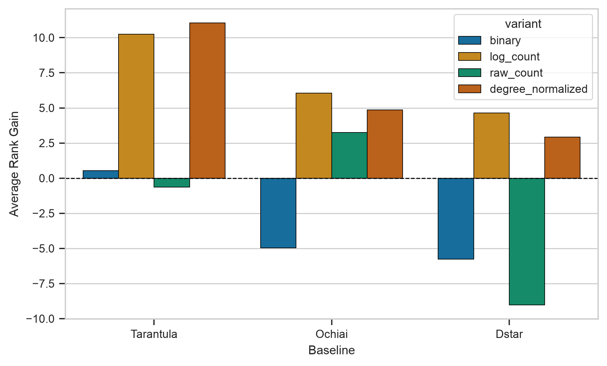
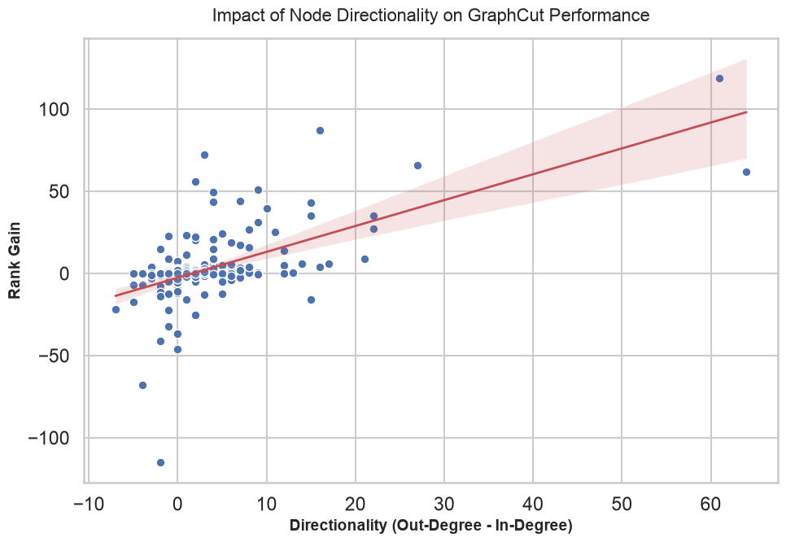
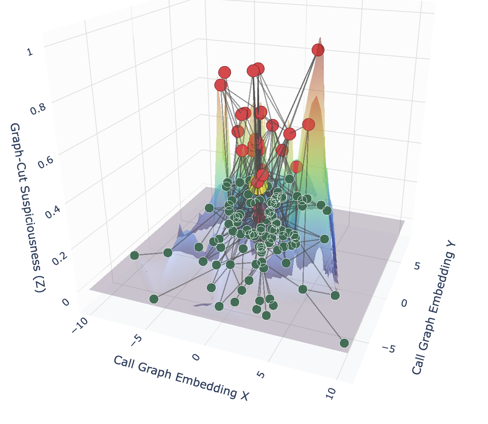
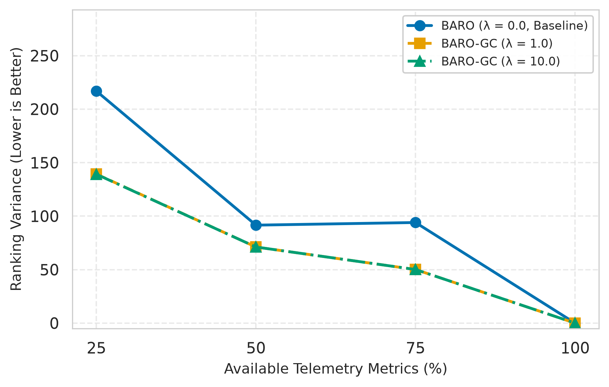
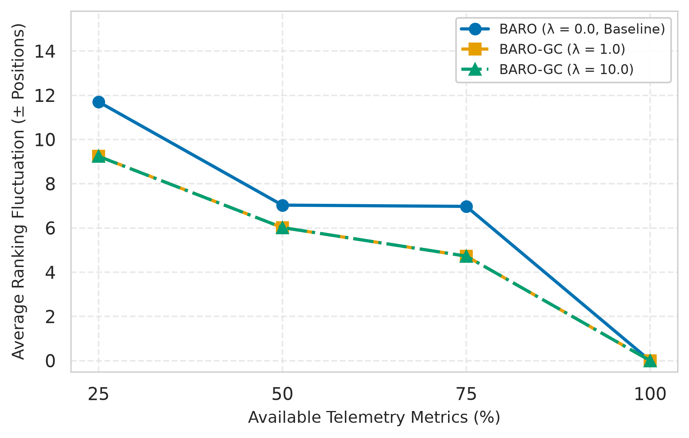
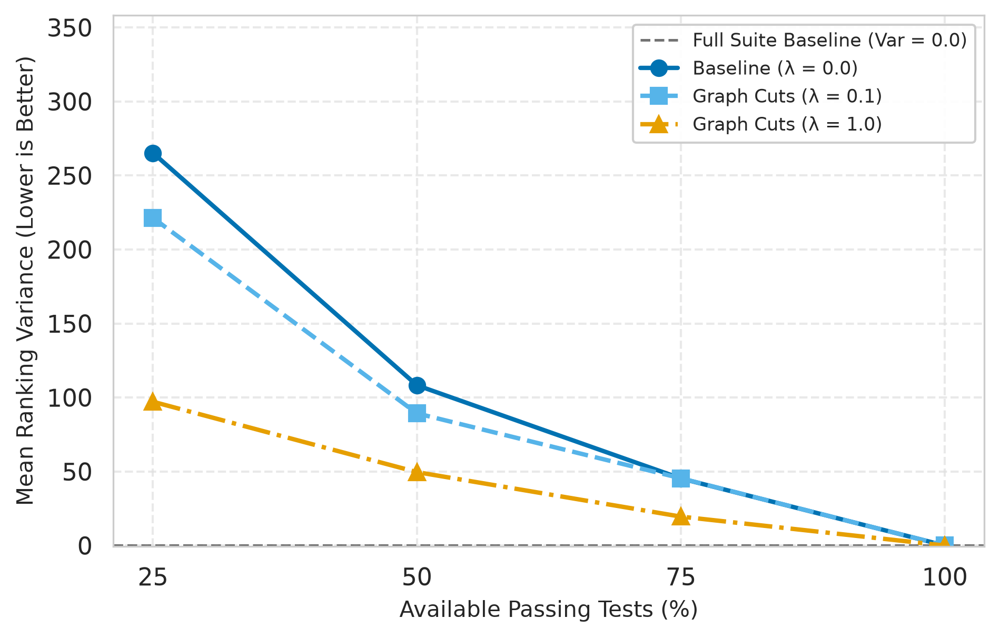
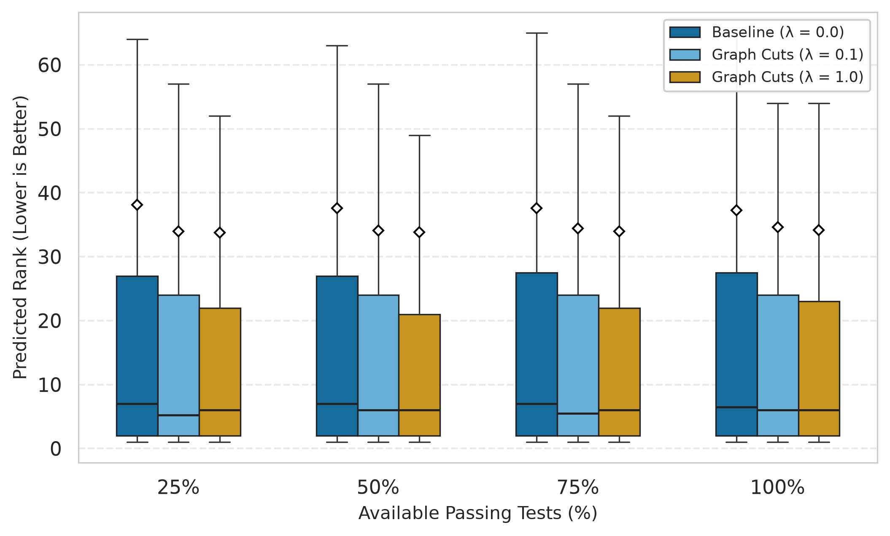

# Failure Propagation and Root-Cause Analysis via Energy Minimization

Locating the root cause of a failure is the same problem at every scale: a defect in one component contaminates the observable behavior of its neighbors, yet traditional Spectrum-Based Fault Localization (SBFL) and microservice Root-Cause Analysis (RCA) score each component in isolation, often ranking the true fault alongside its propagation symptoms.

This work reformulates root-cause localization as a binary labeling problem on a system dependency graph `G`, where each node carries an anomaly score `S_i` (from any existing baseline such as Tarantula, Ochiai, DStar, or BARO) and each edge encodes structural propagation strength; following the graph-cut formulation of Boykov and Jolly, we minimize an energy that fuses this regional evidence with a pairwise structural prior, which under submodularity is solvable exactly in polynomial time via an s-t min-cut. We finally recover a continuous ranking from min-marginal energies. Setting the structural weight `λ = 0` provably recovers the original baseline ranking, so the method strictly generalizes SBFL rather than replacing it. We evaluate on two domains: SBFL on Defects4J and microservice RCA on RCA-Eval (RE2, RE3).

## Installation

### Prerequisites
- [uv](https://docs.astral.sh/uv/) for fast dependency management
- **Python 3.12+**
- **JDK 8+** on your `PATH` (required for the Defects4J Java instrumentation agent)

#### Setup Defects4J (for SBFL Evaluation)
```bash
git clone https://github.com/rjust/defects4j.git
cd defects4j
cpanm --installdeps .
./init.sh
export PATH=$PATH:"$(pwd)/framework/bin"
```

#### Setup RCA-Eval (for Microservice Evaluation)
```bash
git clone https://github.com/phamquiluan/RCAEval.git rca-eval
# Extract the relevant evaluation datasets
```

### Project Setup
```bash
git clone https://anonymous.4open.science/r/failure-propagation-and-rca-via-energy-minimization-8DDA
cd failure-propagation-and-rca-via-energy-minimization

# uv automatically creates a virtual environment and installs dependencies from pyproject.toml
uv sync

# Activate the virtual environment
source .venv/bin/activate        # Windows: .venv\Scripts\activate
```

### Configuration (.env)
Create a `.env` file in the root of the project to configure paths for the Defects4J evaluation. You can copy the structure from `.env.example`:

```bash
# Example .env configuration
JAVA_HOME_PATH=
D4J_PATH=
CALLGRAPH_DIR=
```

## Reproducing the results

The repository uses standalone scripts in the `scripts/` and `src/` directories to run the evaluations. Configuration (like target lambdas and datasets) is managed in `src/evaluation/config.py`.

```bash
# 1. Run the RCA (Microservices) Evaluation Pipeline
uv run python src/evaluation/rca_eval.py

# 2. Run the SBFL (Defects4J) Extraction and Experiments
uv run python scripts/run_sbfl_experiments.py

# 3. Run the complete benchmark evaluation (controlled via config.py)
uv run python scripts/run_evaluation.py
```

**Notes**
- Configuration for the evaluation sweeps (such as `LAMBDAS_TO_ABLATE`, `SAMPLE_SIZE`, and `BENCHMARK_TARGET`) is located in `src/evaluation/config.py`. Adjust this file before running `run_evaluation.py`.
- Outputs from the evaluations are saved as CSVs to directories like `outputs_complete_directional_full_benchmark/`, `outputs_rca/`, or `sensitivity-analysis/rca/outputs/`.

---

## Key Results

All headline numbers use **degree-normalized log coupling**

```
C_uv = ln(1 + c_uv) / sqrt( deg(u) · deg(v) )
```

with average-rank tie-breaking and `λ = 0.1` in both domains. Corpora after filtering: **Defects4J N = 266** (16 Java projects) and **RCA-Eval N = 360** (RE2 Online-Boutique 270, RE3 Train-Ticket 90). RE1 is excluded because it ships aggregated time series without the distributed traces needed to infer topology.

### 1. Localization accuracy

Top-k is the absolute count of localized faults. MRR higher is better; MAR, WEF, EXAM lower is better.

| Algorithm | Top-1 | Top-3 | Top-5 | MRR | MAR | WEF | EXAM |
|---|---:|---:|---:|---:|---:|---:|---:|
| *SBFL: Defects4J (N = 266)* | | | | | | | |
| Tarantula | 44 | 94 | 126 | 0.374 | 15.31 | 14.31 | 0.12 |
| **Tarantula GC** | **60** | **103** | **135** | **0.422** | **13.50** | **12.50** | **0.11** |
| Ochiai | 40 | 94 | 126 | 0.361 | 23.10 | 22.10 | 0.15 |
| Ochiai GC | 44 | 92 | 116 | 0.384 | 22.70 | 21.70 | 0.15 |
| DStar | 42 | 95 | 126 | 0.363 | 23.20 | 22.20 | 0.15 |
| DStar GC | 44 | 94 | 122 | 0.374 | 22.53 | 21.53 | 0.14 |
| *RCA: RCA-Eval (N = 360)* | | | | | | | |
| BARO | 107 | 226 | 234 | 0.664 | 2.57 | 1.57 | 0.11 |
| BARO GC | 107 | 226 | 233 | 0.664 | 2.55 | 1.55 | 0.11 |

- **Tarantula improves uniformly and substantially** (+16 at Top-1, 44 → 60), which makes GC-Tarantula the strongest Top-1 localizer in the study, ahead of the GC variants of the sharper Ochiai and DStar, and 20 instances ahead of the raw Ochiai baseline. Since Naish et al. (2011) showed that many SBFL metrics collapse to mathematically equivalent rankings under standard conditions, a gain of this size has to come from topology rather than from the formula.
- **Ochiai and DStar see minor Top-1 gains and stay neutral-to-slightly-negative deeper in the list.** Ochiai drops 126 → 116 at Top-5. This is the expected diminishing-returns behavior of a smoothness prior, but it matters if you operate on a hard Top-5 budget.
- **BARO is essentially unchanged**: identical Top-1, Top-3, MRR and EXAM, one fewer fault in Top-5, and a marginally lower MAR. BARO is already sharp, so there is little ambiguity for smoothing to resolve. Its scores may also embed their own smoothing, which would leave the pairwise term little new to add.

### 2. Pairwise coupling: degree normalization is a correctness constraint

<p align="center">
  <br/>
  <sub><b>Figure 1.</b> Average rank gain (higher is better) by pairwise coupling function, across the three SBFL baselines. Raw counts cause the worst regressions in the study; degree-normalized log coupling is the only variant that stays at or above zero everywhere.</sub>
</p>

| Variant | `C_base(u,v)` | Behavior |
|---|---|---|
| `none` | `0` | Exactly zero rank change on every instance. This is the control that verifies the strict-generalization property. |
| `binary` | `1` | Unweighted smoothing. Net-negative on Ochiai and DStar. |
| `raw_count` | `c_uv` | Most unstable. Produces the largest regressions in the sample (the true fault dropped by roughly 95 and 130 ranks on two JacksonDatabind instances). |
| `log_count` | `log(1 + c_uv)` | Logarithmic compression dampens the extreme outliers, but regressions persist. |
| **`degree_normalized`** | **`log(1 + c_uv) / √(deg(u)·deg(v))`** | **Consistently at or above zero across the sample; the most robust worst-case behavior.** |

The culprit is **volume bias**: with raw counts, the penalty to separate a node grows linearly with its degree, so utility hubs get pulled to their neighborhood's majority label regardless of their own evidence. Degree normalization caps a hub's total cut capacity while keeping the energy exactly solvable.

### 3. Sensitivity to `λ`

`λ` controls the balance between local evidence and structural coherence. At `λ = 0` the pairwise term vanishes and the baseline ranking is recovered exactly; as `λ` grows, nodes are increasingly forced toward their neighbors' labels. We sweep `λ ∈ {0, 0.01, 0.1, 1.0}`.

- **SBFL (Defects4J).** Median true-fault rankings stay stable across the sweep. For Tarantula, raising `λ` to `1.0` improves the ranking of difficult, poorly separated instances without hurting the easy ones. Ochiai and DStar stay mostly flat. Smoothing primarily benefits high-entropy baselines, which makes `λ` a low-risk parameter on source-level graphs.
- **RCA (RCA-Eval).** The effect reverses. BARO performs consistently well at `λ = 0.01` and `λ = 0.1`, but its rank distribution widens and degrades significantly at `λ = 1.0`.
- **Why they diverge.** Defects4J call graphs are large and densely connected, so the pairwise term can exploit meaningful multi-hop relationships. RCA-Eval service graphs are small and shallow, so a large `λ` quickly overwhelms the limited local evidence. On top of that, BARO is already accurate, so heavy smoothing mostly redistributes mass away from the correct root cause.
- **Rule of thumb:** optimal `λ` scales **directly with graph density** and **inversely with baseline sharpness**. Raise it for noisy baselines on dense graphs, keep it low for sharp baselines on sparse graphs. `λ = 0.1` is a safe cross-domain default: it captures most of the SBFL benefit without penalizing RCA.

### 4. Directionality drives rank gain

<p align="center">
  <br/>
  <sub><b>Figure 2.</b> Rank gain vs. net directed degree (callees minus callers) of the faulty method. Spearman ρ = +0.56, p &lt; 0.001, N = 227.</sub>
</p>

Across all tested baselines and configurations, the correlation between callee count and rank improvement is consistently positive. Source-like faults that propagate failures downstream are correctly promoted by the directed coupling; caller-heavy near-leaf faults lose support and regress. Because this directional split is invariant to the underlying metric, it defines the failure regimes below.

### 5. Failure regimes

1. **Faults surrounded by innocent neighbors.** The smoothness prior assumes a neighborhood should share similar suspicion, so a bug localized in a cluster of unexercised callees is effectively silenced. This is a shrinkage bias that pulls the high-suspicion node down toward its neighbors' low-suspicion average.
2. **Caller-heavy faults.** A near-leaf fault with more callers than callees has no downstream support base to draw from; its own suspicion flows upward and elevates its callers instead. Nodes that overtake the true fault are fourfold enriched in upstream callers relative to the graph's base rate (0.35 vs. 0.08).
3. **Over-smoothing at large `λ`.** Beyond roughly `λ = 1.0`, the structural prior aggregates mass from distant or unrelated nodes and dilutes the localized signal. Noisy baselines like Tarantula still benefit, but precise baselines regress on mean rank (DStar −0.67, Ochiai −0.35).

<p align="center">
  <br/>
  <sub><b>Figure 3.</b> Regime 1 made concrete: the post-cut energy landscape of the Defects4J Jsoup_51 neighborhood. The true fault (yellow) sits in a basin because it is tied to 97 unexecuted neighbors (green, Z = 0), which flatten its suspiciousness, while competitors in densely executed subgraphs (red peaks) keep theirs and overtake it. The fault falls from rank 89 to rank 153.</sub>
</p>

### 6. Cost

Adding the structural prior is cheap relative to the pipeline it attaches to. Profiling end-to-end Defects4J bug extraction, exporting the graphs and parsing runtime traces account for roughly **12%** of total execution time, while running the test suite to collect baseline coverage, which is mandatory for any SBFL approach, consumes about **56%**. Computing min-marginals is amortized linear time once the initial optimal cut is available (Kohli and Torr, 2006).

---

## Sensitivity & Robustness Analysis

We test whether the structural prior stabilizes rankings when the underlying evidence is degraded. These runs use a subsample of N = 253, selected after filtering out instances that do not have sufficient data for resampling.

### Microservice RCA: missing telemetry and short windows

<table align="center">
  <tr>
    <td align="center" width="50%">
      <br/>
      <sub><b>(a)</b> Variance of the true root cause's rank across dropout draws.</sub>
    </td>
    <td align="center" width="50%">
      <br/>
      <sub><b>(b)</b> Average rank fluctuation of the true root cause.</sub>
    </td>
  </tr>
</table>
<p align="center"><sub><b>Figure 4.</b> Rank stability under telemetry metric dropout (RCA-Eval, N = 253). The structural prior stabilizes the ranking most when data is sparse, and the gap closes as full metric availability is restored.</sub></p>

| Metric availability | Base mean var | GC mean var | Δ Var | t-stat | p-value |
|---|---:|---:|---:|---:|---:|
| 25% | 216.84 | 139.28 | −35.8% | 9.073 | 1.70e-17 |
| 50% | 91.56 | 71.12 | −22.3% | 3.264 | 6.26e-04 |
| 75% | 94.01 | 50.09 | −46.7% | 6.944 | 1.61e-11 |

- **Metric dropout:** the prior cuts within-instance rank variance by 22.3% to 46.7% (Wilcoxon p = 9.30e-36 at 25% availability). The gap closes as telemetry is restored, which is exactly what you want from a prior: it helps when evidence is thin and steps aside when it is complete.
- **Observation windows:** sweeping `T ∈ {1, 2, 5, 10, 20}` minutes, BARO-GC improves mean rank by **+1.06 to +1.35 positions** (p < 0.05) in the standard 5 to 20 minute triage band, giving equivalent diagnostic accuracy with up to 10x less observation time. At 2 minutes it is inert, because too few traces exist to build a connected dependency graph (a *graph-observability floor*).
- `λ = 1.0` and `λ = 10.0` are indistinguishable here: on small, shallow service graphs the structural signal saturates quickly, so the gain comes from activating the prior at all rather than from tuning its weight.

### Defects4J SBFL: passing-test subsampling

<table align="center">
  <tr>
    <td align="center" width="50%">
      <br/>
      <sub><b>(a)</b> Mean rank variance of the true fault vs. passing-test budget, baseline vs. graph cut.</sub>
    </td>
    <td align="center" width="50%">
      <br/>
      <sub><b>(b)</b> Distribution of per-instance rank variance at each test budget.</sub>
    </td>
  </tr>
</table>
<p align="center"><sub><b>Figure 5.</b> Rank stability under passing-test subsampling (Defects4J, 10 draws per budget, λ = 1.0). Graph cuts dampen variance most at the smallest test budgets.</sub></p>

| Test budget | Base mean var | GC mean var | Δ Var | t-stat | p-value |
|---|---:|---:|---:|---:|---:|
| 25% | 263.45 | 96.49 | −63.4% | 1.351 | 0.089 † |
| 50% | 107.54 | 49.27 | −54.2% | 0.815 | 0.208 |
| 75% | 45.03 | 19.40 | −56.9% | 0.997 | 0.160 |

† marginally significant (p ≤ 0.10).

Pairwise regularization at `λ = 1.0` reduces mean rank variance by **63.4%** at a 25% test budget (263.45 → 96.49) and **54.2%** at a 50% budget (107.54 → 49.27), with up to **45.6%** of defects showing significant per-instance dampening, though the benchmark-level tests are underpowered. The prior acts like a low-pass filter over the call graph, with the caveat that isolated faults surrounded by uncovered neighbors can pick up a rank offset.

### Reproducing the sensitivity ablations

```bash
# Run the metric sparsity and window duration factorial sweep
uv run python sensitivity-analysis/rca/run_rca_sensitivity.py

# Compute paired t-tests, Wilcoxon tests, and p-values
uv run python sensitivity-analysis/rca/statistical_significance_rca.py

# Generate sensitivity plots and charts
uv run python sensitivity-analysis/rca/plot_rca_sensitivity.py
```

